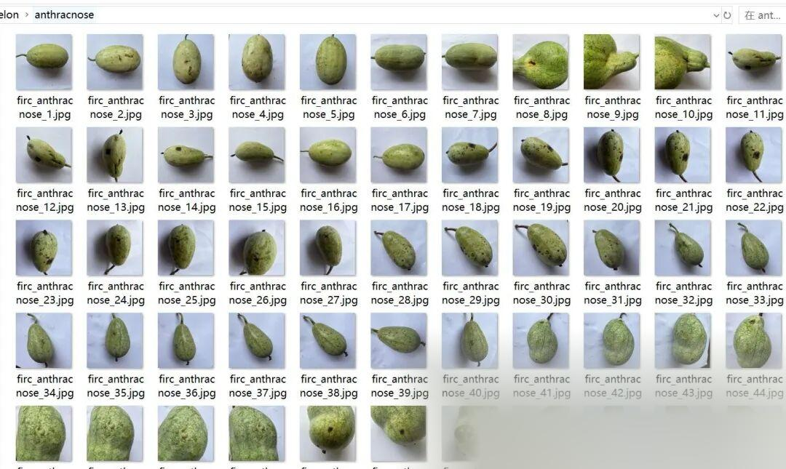
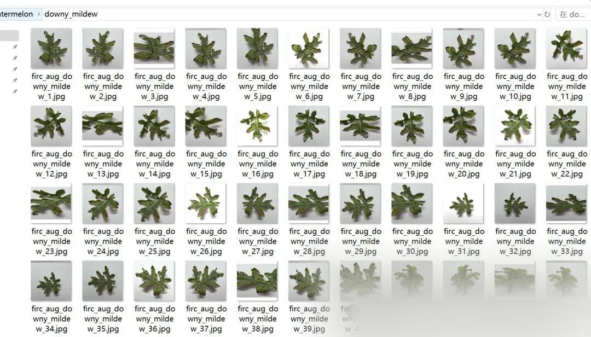
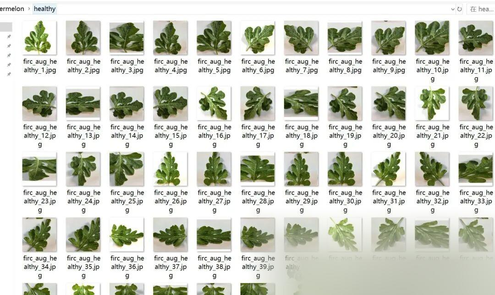
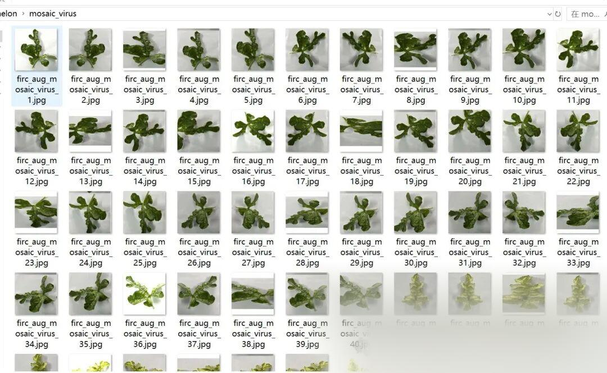

# Melon Disease Classification Dataset: 6930 Images in 4 Categories

Dataset type: Image classification, not for object detection without annotations.

Dataset format: Only contains jpg images, each category folder contains the corresponding image.

Number of images (number of jpg files): 6930

Category: 4

Category Name: ["anthracnose", "downy mildew", "healthy", "mosaic virus"]

Number of images per category:

Anthracnose 930 images

Downy mildew image count: 2280

Healthy image count: 1230

mosaic_virus image count: 2490

Important Notice: No

Special : This dataset does not guarantee the accuracy of the trained models or weight files. The dataset is provided for accurate and reasonable classification storage only.

## Payment

Here is a pay link on Stripe ( https://buy.stripe.com/3cs8yP7sY87d0vu9AB ). Please contact me lonlonago@foxmail.com after funding $89, and I will send you a complete data files , thank you!

